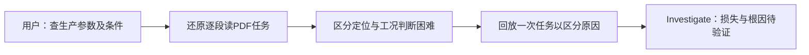
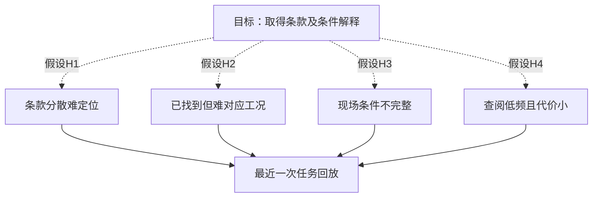
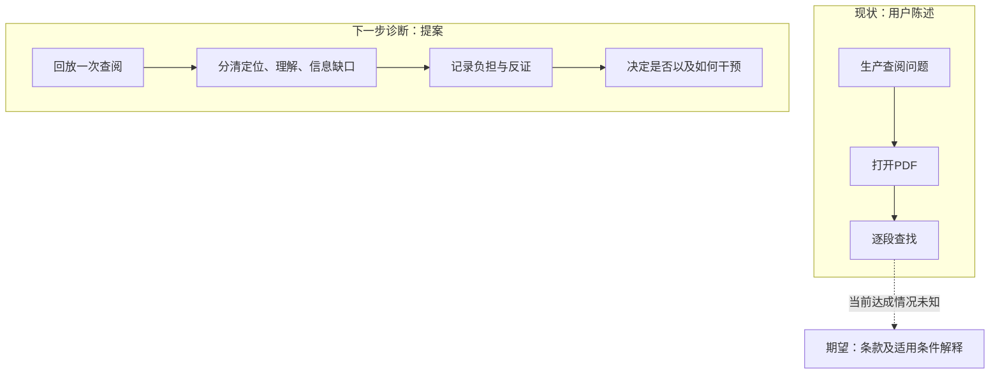
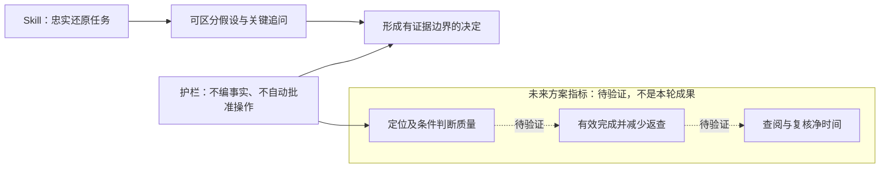

> 历史快照 v0.2.2；不作为当前判断。

> 本页为v0.2.1诊断模型留底；后续已确认主要困难为定位、专家协作有效。最新决策分层见 [判断流程](../../../../references/decision-flow.md)，当前事实以问题卡为准。

# 图示：当前诊断与未来方案分开

## diagnosis

## problem-tree

## workflow

## metrics

虚线为待验证关系；现状来自用户陈述，没有声称现场观察。
